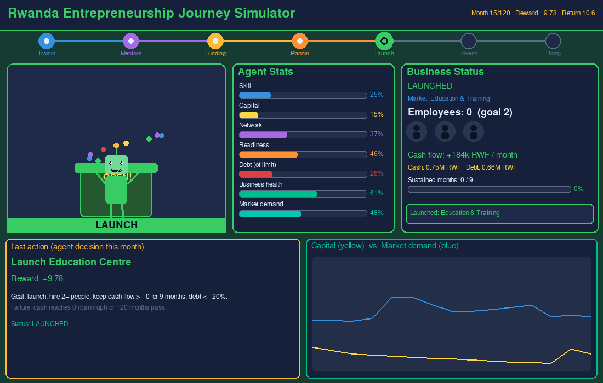

# Rwanda Entrepreneurship Journey Simulator - DQN vs REINFORCE vs A2C vs PPO (TorchRL)

> **Platform note:** this project needs **Apple Silicon (M1/M2/M3/M4) Macs, Windows 64-bit, or Linux**.
> It will not install on Intel Macs, because PyTorch 2.3 and later (required by TorchRL 0.15) no longer
> ships Intel-Mac builds. On an Intel Mac, `uv sync` fails with a "doesn't have a wheel for the current
> platform" error. This is a PyTorch limitation, not a bug in the project.

An agent guides a young Rwandan from "little skill, little cash" to a **sustainable micro-business with at least two
employees**. One step = one month. The agent chooses from 11 actions (train, mentor, loan, plan, launch retail /
digital / education, hire, invest, repay, wait) in a stochastic economy (random demand shocks, random loan approval,
noisy market survey). Four algorithms are trained with **TorchRL** on the same environment and the same budget.



## Run it (uv only)
```bash
uv sync                      # installs everything from pyproject.toml / uv.lock
uv run main.py               # GUI + terminal output of the best trained agent
uv run main.py --algo ppo    # best model of one algorithm: dqn | reinforce | a2c | ppo
uv run main.py --random      # random actions, no model (environment demo)
uv run main.py --headless    # terminal output only (no window)
uv run pytest                # 24 tests
uv run main.py --train       # full study: 4 algorithms x 10 runs + analysis (~2 h on 1 CPU core)
uv run main.py --analyze     # rebuild tables / figures from logs/
uv sync --extra api && uv run main.py --api   # JSON API on :8000 (open assets/dashboard.html)
```
`RL_TOTAL_FRAMES=20000 uv run main.py --train` runs a quick smoke version.

## Project layout
```
environment/custom_env.py   Gymnasium env (actions, observations, rewards, dynamics)
environment/rendering.py    Pygame dashboard (robot, journey tracker, stat bars, chart)
environment/baselines.py    random + scripted-expert reference policies
environment/api.py          FastAPI wrapper (JSON state for a web / mobile front end)
training/                   dqn_training.py, pg_training.py (REINFORCE, A2C, PPO), configs.py, analysis.py
models/dqn, models/pg       every run's model + best_<algo>.pt ; models/best_overall.json
logs/                       per-run JSON (hyper-parameters, episode returns, losses, entropy)
results/                    tables (CSV) and figures used in the report
report/                     the written report (.docx)
play.py / main.py           entry points
```

## Environment in one table
| Observation (14) | Actions (11) |
|---|---|
| skill, capital, network, readiness, debt, demand survey (noisy), business health, employees, cash flow, time left, launched, market one-hot (3) | 0 Training, 1 Mentorship, 2 Micro-loan, 3 Business plan, 4 Retail, 5 Digital, 6 Education, 7 Hire, 8 Invest, 9 Repay, 10 Wait |

Success = launched, >= 2 employees, cash flow >= 0 and debt <= 0.2 for 9 consecutive months. Failure = cash <= 0 or 120 months.
Reward: -0.05 per month; shaping on skill / network / readiness increases; 4 x change in net worth (capital - debt);
+10 launch, +6 per early hire, +30 success, -15 bankruptcy. Full details and the observation provenance table are in the report.

## Results (100k steps per run, seed 0 for the sweep)
Held-out test, 100 unseen seeds, best model of each algorithm:

| Agent | Success | Return | Recession scenario |
|---|---|---|---|
| DQN | 100% | 60.2 | 94% |
| PPO | 95% | 57.7 | 68% |
| REINFORCE | 83% | 47.1 | 46% |
| A2C | 69% | 37.9 | 24% |
| Scripted expert (sees true state) | 98% | 55.3 | 86% |
| Random | 2% | -37.4 | 0% |

**Caveat - seed variance.** These are the best of ten seed-0 runs. Retraining each best configuration on three new
seeds gave mean success of DQN 75%, PPO 59%, A2C 36%, REINFORCE ~0%. Single-seed tuning overstates performance;
A2C and REINFORCE often collapse to a deterministic "wait" policy (return about -19.6). The simulator is not calibrated
to real Rwandan data.

Hyper-parameter tables (10 runs per algorithm): `results/table_*.csv` and `results/sweep_summary.csv`.

## Notes
* Policy-gradient models are evaluated by sampling from their policy; DQN greedily.
* TorchRL has no REINFORCE class, so its loss is written by hand on top of TorchRL envs / actors.
* Models were trained on CPU with torch 2.15 / torchrl 0.15 (locked in `uv.lock`).
